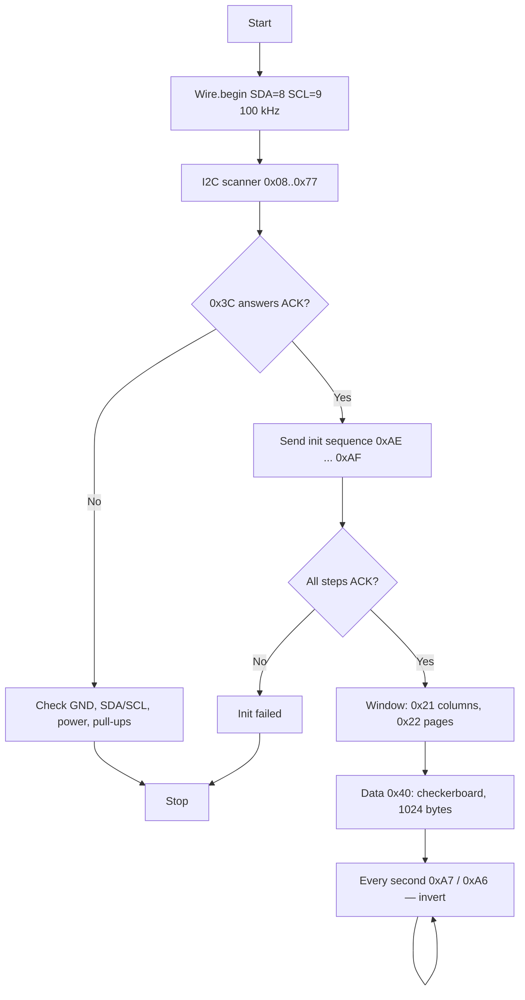

# Module 4.2. I²C: SSD1306 OLED Display Plan

Display: 0.96" OLED 128×64, GM009605 v4.3 module, SSD1306 controller.
Board: ESP32-S3 DevKitC-1, Arduino framework, Wire at 100 kHz, SDA = GPIO8, SCL = GPIO9.
Pull-ups: 10 kΩ to 3V3 (the lecture recommends 4.7 kΩ; 10 kΩ is enough at 100 kHz with short wires).

## Datasheet Summary

- **SSD1306**: address 0x3C (8-bit form: 0x78/0x79). Control byte: `0x00` = commands follow, `0x40` = data follow.
  The 128×64 memory is split into 8 pages of 8 rows each; 1 byte = a vertical strip of 8 pixels.
- **DS1307**: address 0x68. Registers 0x00–0x06 (seconds, minutes, hours, day, date, month, year) in BCD.
  The CH bit (bit 7 of register 0x00) set to 1 stops the clock. Powered from 5 V.
- **AT24C32**: address 0x50–0x57 (set by A0–A2). Memory address is 2 bytes, writes go in 32-byte pages,
  and the chip answers NACK for about 5 ms after each write.

## Init Sequence (address 0x3C, control byte 0x00)

1. `0xAE` — Display OFF
2. `0xD5, 0x80` — clock divide ratio / oscillator frequency
3. `0xA8, 0x3F` — multiplex ratio 64 (`0x1F` for 32 rows)
4. `0xD3, 0x00` — display offset 0
5. `0x40` — start line 0
6. `0x20, 0x00` — horizontal addressing mode
7. `0xA1` — segment remap
8. `0xC8` — COM scan direction descending
9. `0xDA, 0x12` — COM pins configuration for 64 rows (`0x02` for 32 rows)
10. `0x81, 0xCF` — contrast
11. `0xD9, 0xF1` — pre-charge period
12. `0xDB, 0x40` — VCOMH deselect level
13. `0x8D, 0x14` — charge pump ON
14. `0xA4` — display follows RAM content
15. `0xA6` — normal (non-inverted) display
16. `0x2E` — scroll OFF
17. `0xAF` — Display ON

Drawing an image:

1. `0x00, 0x21, 0, 127` — column range 0–127
2. `0x00, 0x22, 0, 7` — page range 0–7
3. `0x40, …` — 1024 pixel bytes, sent in 16-byte chunks

## Flowchart

## Results

- Log: `results/esp32-log.txt`
- Display photo: `results/oled-checkerboard.jpg`